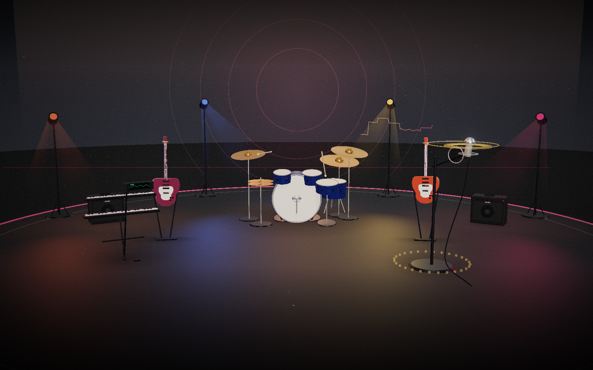
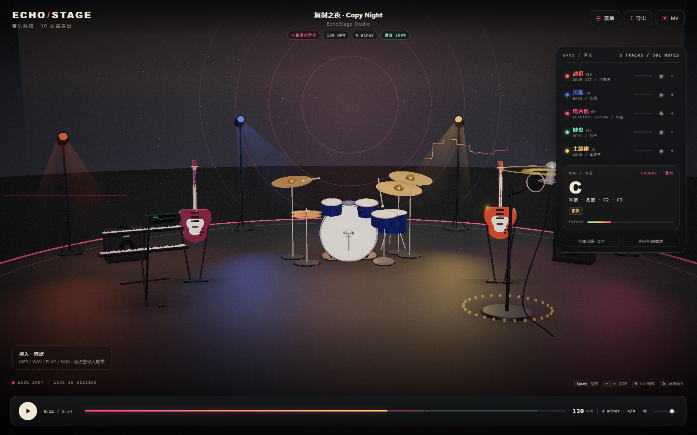
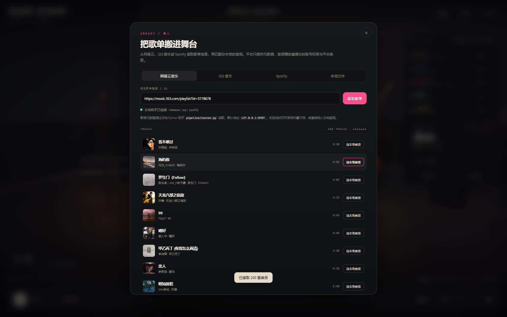
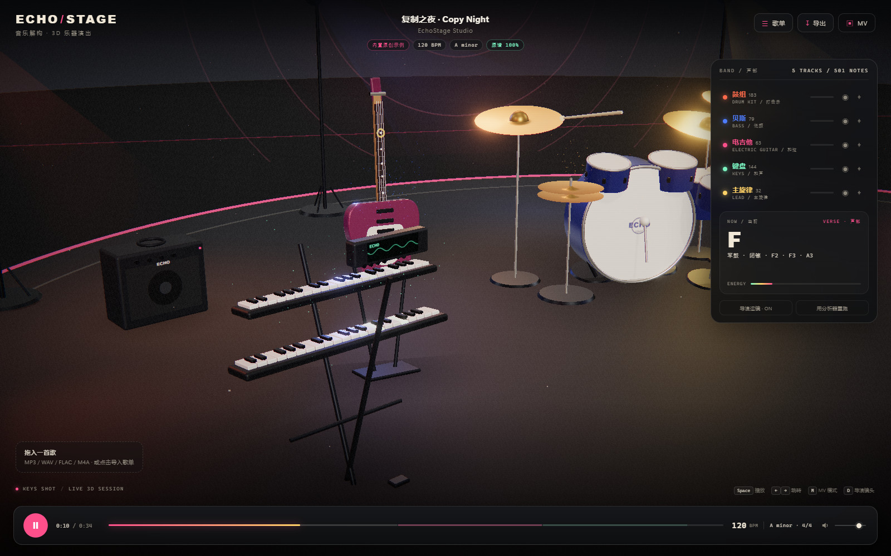
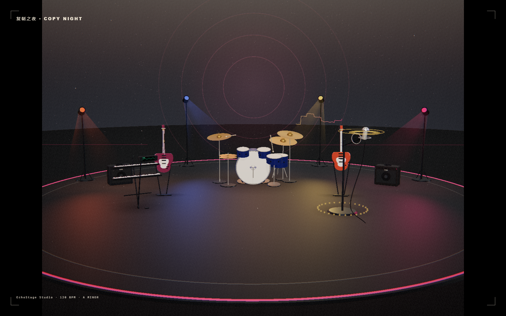
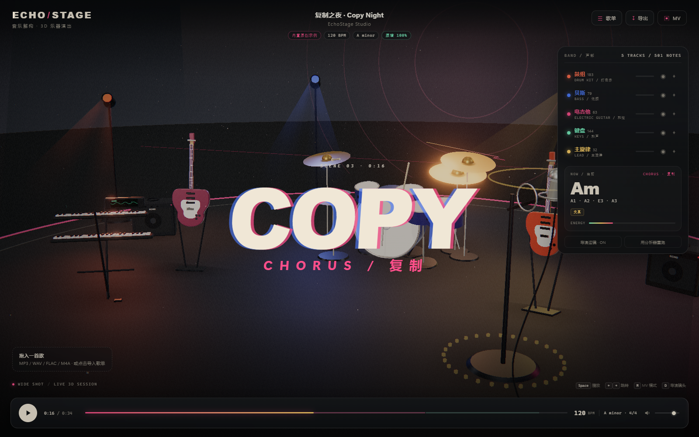

# EchoStage · 回响舞台

[**▶ 在线体验 Live Demo**](https://kilakiller.github.io/echostage/) · [GitHub 仓库](https://github.com/kilakiller/echostage)

> 把任何一首歌拆成一支会演奏的 3D 乐队。
> 从音频里识别鼓、贝斯、吉他、键盘与人声，把每一个音符、力度、颤音、失真和掌闷映射到具体乐器与舞台灯光上。



这是一个**可运行的原型 + 完整系统设计**：

- **3D 灰棚舞台**：鼓组、四弦贝斯、六弦电吉他、双层键盘、电容麦克风，全部由 Three.js 程序化建模，无外部模型文件。
- **演奏动画**：鼓棒敲击、镲片晃动、琴弦振动、品位光点、琴键下压、声码器频谱、颤音光环、音箱纸盆起伏。
- **音乐解构**：内置示例曲原谱 + 浏览器快速分析器（节拍、鼓点、贝斯/主旋律音高、和弦、段落、演奏效果）。
- **歌单导入**：本地 Python 助手已实测可读取网易云与 QQ 音乐歌单元数据（200 首/单），Spotify 走官方 API。
- **导出**：PerformanceScore JSON 与多轨 MIDI，可继续进 DAW。
- **MV 模式**：4:3 画幅、字卡、电影颗粒、色差与暗角，参考 nonose《复制我！》的灰棚玩具美学。

---

## 快速开始

**在线版**：<https://kilakiller.github.io/echostage/>  
GitHub Pages 是纯静态托管：示例曲、3D 舞台、本地音频分析、MIDI/JSON 导出都可直接用；歌单助手需要在本机运行，在线版会提示未连接。

**本地完整版**（含歌单导入）：

需要 **Python 3.10+**（仅标准库即可启动）与支持 WebGL2 的 Chrome / Edge。

```bash
# 方式一：双击
start.cmd

# 方式二：手动
python -m http.server 8777 --bind 127.0.0.1
# 另开一个终端（歌单导入需要）
python pipeline/server.py
# 浏览器打开
http://127.0.0.1:8777/web/
```

不需要 `npm install` 才能运行：Three.js 已本地化在 `web/vendor/`。Node 依赖只用于开发测试与截图。

### 试玩路径

1. 打开页面，会自动加载 32 秒原创示例曲《复制之夜 Copy Night》，使用**内置原谱**，所有乐器与音符 100% 对齐。
2. 点播放。相机按段落自动切镜；右侧面板显示当前和弦、音符、演奏效果标签。
3. 点「歌单」，粘贴网易云歌单链接（例如 `https://music.163.com/playlist?id=3778678`），读取 200 首曲目元数据。
4. 把本地 MP3/WAV 拖进页面，或点「本地音频」，体验浏览器快速分析。示例 WAV 在 `docs/reference/demo-song.wav`。
5. 点「导出」下载 JSON / MIDI；点「MV」进入 4:3 无界面模式。

> 浏览器分析是**实验性快速路径**，用于即时预览；高精度转写请走 `pipeline/analyze.py` 的 Demucs + Basic Pitch 管线。

---

## 界面

| 主界面 | 歌单导入 |
|---|---|
|  |  |

| 播放中的键盘近景 | MV 模式 |
|---|---|
|  |  |

| 段落字卡 |
|---|
|  |

---

## 工作原理

```
歌单元数据 ──► 曲目匹配 ──► 音频（本地 / 授权试听）
                                   │
                                   ▼
                        解码 / 重采样 / 单声道
                                   │
                ┌──────────────────┴──────────────────┐
                ▼                                     ▼
      Demucs 6 轨源分离                    浏览器快速分析（本原型）
      鼓 / 贝斯 / 吉他 / 钢琴 / 人声 / 其他        节拍 · 频段 · YIN · 和弦模板
                │                                     │
                ▼                                     ▼
      YourMT3 / Basic Pitch / ADTOF / CREPE     鼓点 · 音高 · 和弦 · 段落
                │                                     │
                └──────────────────┬──────────────────┘
                                   ▼
                        PerformanceScore（统一乐谱 JSON）
                                   │
              ┌────────────────────┼────────────────────┐
              ▼                    ▼                    ▼
        3D 乐器演奏引擎        多轨 MIDI 导出        JSON / 二次创作
        灯光 · 粒子 · 运镜
```

详细设计见 **[docs/01-系统设计.md](docs/01-系统设计.md)**。

---

## 项目结构

```
MusicStage3D/
├─ web/                         # 可运行 Web 原型（原生 ES Modules）
│  ├─ index.html
│  ├─ css/style.css
│  ├─ js/
│  │  ├─ app.js                 # 播放器 / UI / 导入 / 导出
│  │  ├─ audio-engine.js        # Web Audio 时钟与分析器
│  │  ├─ dsp.js                 # FFT / YIN / 起音 / 频谱特征
│  │  ├─ analysis.js            # 节拍 / 鼓 / 音高 / 和弦 / 段落
│  │  ├─ synth.js               # 32 秒原创示例曲合成
│  │  ├─ instruments.js         # 鼓 / 贝斯 / 吉他 / 键盘 / 麦克风建模
│  │  ├─ stage.js               # 灰棚、灯光、光束、粒子、后期
│  │  ├─ director.js            # 自动运镜 / 自由环绕
│  │  └─ analysis-worker.js     # 分析线程
│  └─ vendor/                   # Three.js r186 本地化
├─ pipeline/                    # Python 生产管线与歌单助手
│  ├─ server.py                 # 本地歌单导入助手（已实测）
│  ├─ analyze.py                # Demucs + Basic Pitch 参考实现
│  └─ providers/                # 网易云 / QQ / Spotify
├─ docs/                        # 设计文档、MV 拆解、合规说明
├─ tools/                       # 分析回归、UI 测试、截图
└─ start.cmd
```

---

## 歌单导入现状

| 平台 | 元数据 | 试听音频 | 说明 |
|---|---|---|---|
| 网易云音乐 | ✅ 已实测 200 首 | ❌ | 非官方 Web 接口；不抓取版权音频 |
| QQ 音乐 | ✅ 已实测 30 首 | ❌ | 非官方接口；不抓取版权音频 |
| Spotify | ✅ 官方 API | 视平台返回 | 需 Client ID / Secret；`preview_url` 可为空 |
| 本地文件 | ✅ | ✅ | 浏览器内分析，不上传 |

平台接口随时可能变化；**本项目不绕过登录、付费或 DRM**。完整说明与安全边界见 **[docs/03-歌单导入与合规.md](docs/03-歌单导入与合规.md)**。

---

## 性能与 Edge 优化

针对 Edge 上 144/165Hz 屏幕“明明不卡却一直掉帧”的问题，做了系统性优化：

- **帧率累积器**：不再用固定间隔丢帧，165Hz/144Hz 屏幕上稳定输出约 60fps，而不是被锁到 55fps。
- **像素预算 + 动态分辨率**：按画布面积限制 DPR，避免 4K/高分屏直接按 2× 渲染。
- **自动画质**：播放中持续测帧率，低于阈值自动从「精细 → 均衡 → 流畅」降级；右下角会显示当前档位。
- **半分辨率 Bloom**：辉光内部按半分辨率计算，合成仍全分辨率。
- **阴影降级**：只有「精细」开启实时阴影，且每 2 帧更新一次；「均衡/流畅」使用烘焙感接触阴影。
- **减少 compositor 开销**：移除侧栏/播放条上的全屏 `backdrop-filter`，降低颗粒叠加与混合模式。
- **暂停渲染**：打开歌单弹窗、分析遮罩时暂停 3D 渲染，关闭时用 `warmUp` 追帧。
- 手动强制画质：`?quality=low` / `?quality=medium` / `?quality=high`。

实测（Edge + RTX 4060 Laptop，1920×1080 CSS / 1.25 DPR）：**High 约 61fps**，无 console error；165Hz 屏幕上也不再掉到 55fps。

---

## 部署到 GitHub Pages

仓库内置 `.github/workflows/pages.yml`：推送到 `main` 后，GitHub Actions 会把 `web/` 目录作为静态站点发布。

- Live：<https://kilakiller.github.io/echostage/>
- 首次部署需要在仓库 Settings → Pages 选择 **GitHub Actions** 作为 Source。
- 在线版没有 `pipeline/server.py` 歌单助手；平台歌单导入请在本地运行。

---

## 设计文档

- **[系统设计：从音频到 3D 演出](docs/01-系统设计.md)** — 拆轨、转写、效果提取、乐谱协议、3D 映射、导演系统、部署与成本。
- **[参考 MV 视觉拆解](docs/02-参考MV视觉拆解.md)** — nonose《复制我！》的灰棚、玩具乐器、手绘小人、字卡与故障复制。
- **[歌单导入与合规](docs/03-歌单导入与合规.md)** — 平台矩阵、接口、代理安全、版权边界。

参考视频：[【知声】复制复制复制复制我！！！/コピー·ミー](https://www.bilibili.com/video/BV1gJJ6zhECc/)

---

## 已验证

- `node tools/analyze-demo.mjs`：示例曲合成 + 浏览器分析器回归，输出节拍/和弦/声部统计。
- `node tools/ui-test.mjs`（需 Edge + 本地服务）：播放、真实网易云歌单导入、WAV 上传分析、MV 模式，全程无页面错误。
- `node tools/test-midi.mjs`：多轨 MIDI 导出校验（`MThd`，6 轨，4473 bytes）。
- 浏览器截图：`docs/reference/hero.png`、`final-wide.png`、`playing.png`、`playlist.png`、`mv-final.png`、`type-card-still.png`。

## 已知限制

- 浏览器快速分析对复杂混音的和弦/低音准确率有限；默认示例使用内置原谱，保证演出质量。
- 网易云 / QQ 只返回元数据，不提供可播放音频；需搭配你拥有版权的本地文件。
- 3D 乐器是程序化“玩具”风格，不是真实乐器 CAD 级模型；可通过 GLB 替换。
- 4:3 MV 模式会自动拉远镜头以适配画幅。

## License / 版权

- 代码：MIT（见 `LICENSE`）。
- 示例曲《复制之夜 Copy Night》：为本项目原创合成，可随项目演示使用。
- 参考 MV 的封面、分镜截图仅用于视觉分析，版权归原作者 nonose / twelvetonine / 知声及平台所有，不随产品分发。
- 请只分析你拥有版权或已获授权的音频。
