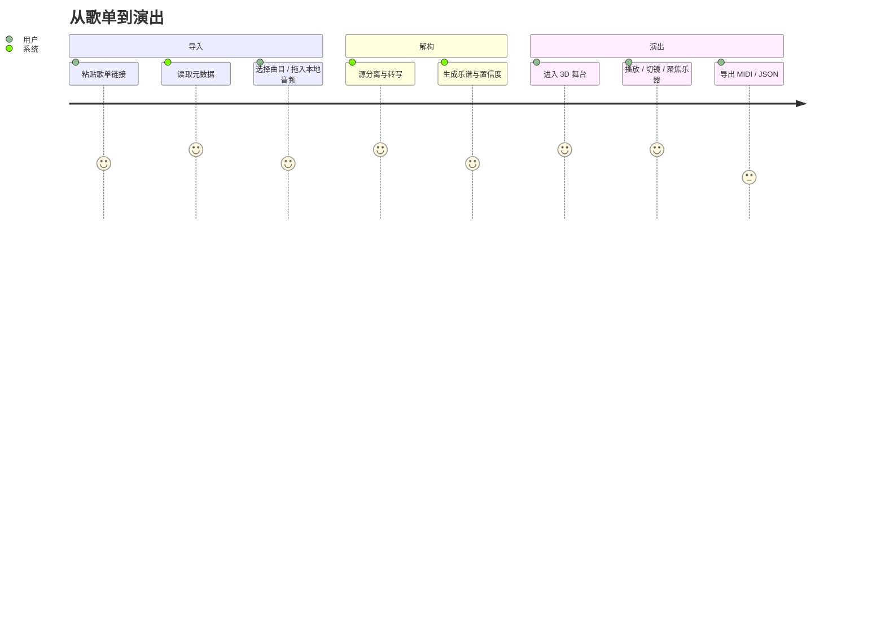
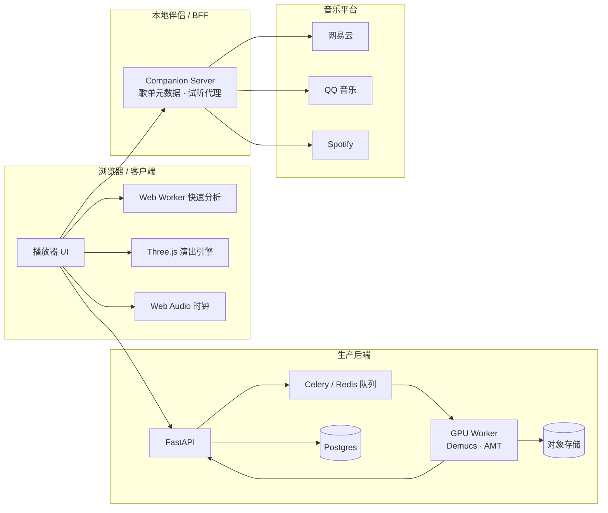

# EchoStage 系统设计
### 从一首歌，到一支会演奏的 3D 乐队

> 版本 0.1 · 2026-10  
> 本文同时描述 **本仓库可运行原型** 与 **生产级实现方案**，并明确两者的边界。

---

## 0. 一句话

输入一首歌（本地音频或平台歌单），系统把它解构成 **鼓、贝斯、吉他、键盘、主旋律** 五个声部的音符与演奏法，再把每个音符映射到灰棚舞台上对应乐器的动作、灯光与镜头，输出一场可播放、可导出、可二次创作的 3D 演出。

---

## 1. 目标与非目标

### 1.1 目标

1. **听得出来**：能从混音里分出主要乐器，输出音高、起音、时值、力度。
2. **演得出来**：音符必须能驱动具体乐器模型，而不是只会跳动频谱。
3. **看得进去**：舞台、灯光、镜头要有 MV 级审美，而不是技术 Demo。
4. **进得来**：支持网易云 / QQ 音乐 / Spotify 歌单元数据导入，本地音频一键分析。
5. **带得走**：输出统一 `PerformanceScore` JSON 与多轨 MIDI。
6. **可解释**：每个声部标注“实测 / 推断 / 置信度”，不把猜测伪装成事实。

### 1.2 非目标

- 不做音乐下载器，不绕过平台 DRM、付费或登录限制。
- 不做专业制谱软件（MuseScore / Dorico）的替代品。
- 不承诺对任意复杂混音做到录音室级转写。
- 不复制参考 MV 的角色、插画、歌词或编曲；只借鉴其**视觉语言**。

---

## 2. 用户旅程



关键体验约束：

- **首屏 3 秒内要有东西可看**：示例曲必须秒开，不能等模型。
- **分析过程要可感知**：显示“解码 → 节拍 → 分轨 → 音符 → 编排”阶段，而不是白屏转圈。
- **失败要可恢复**：平台接口挂了仍可拖本地文件；某声部缺失时舞台隐藏该乐器而非报错。

---

## 3. 总体架构



### 3.1 两条分析路径

| | 浏览器快速分析 | 生产离线管线 |
|---|---|---|
| 目的 | 即时预览、隐私、离线 | 高精度、可缓存、可批量 |
| 技术 | FFT / 频段通量 / YIN / 和弦模板 | Demucs + YourMT3 / Basic Pitch / ADTOF / CREPE |
| 速度 | 30 秒歌 < 1.5 秒 | 30–90 秒 / 首（GPU） |
| 准确率 | 中低，复杂混音易错 | 高，可做人工校正 |
| 成本 | 0 | GPU 成本 |
| 本仓库 | ✅ | ✅ 参考实现 `pipeline/analyze.py` |

生产环境建议 **先用浏览器快速结果占位，再异步替换为高精度结果**，用户无需等待。

---

## 4. 音乐解构

### 4.1 预处理

1. `ffmpeg` 解码为 PCM，统一 44.1 kHz / 立体声。
2. 分析用单声道下混；保留立体声用于声像。
3. 峰值归一化，去除直流偏移。
4. 计算音频哈希（`sha256`），用于缓存分轨与转写结果。

### 4.2 源分离

**首选**：Demucs v4 `htdemucs_6s`，输出 `drums / bass / other / vocals / piano / guitar` 六轨。

**更高质量**：MelBand RoFormer（分离更干净，但显存与时间成本更高），适合付费/批量场景。

**工程注意**：

- 分离与转写解耦，分轨 WAV 缓存到对象存储，7–30 天过期。
- 对 4 分钟歌曲，GPU 上 Demucs 大约 30–60 秒；CPU 不建议。
- 分离结果只用于特征提取，不对外提供原始分轨下载，降低版权风险。

### 4.3 分乐器转写

| 声部 | 首选模型 | 备选 | 输出 |
|---|---|---|---|
| 鼓 | ADTOF / 自训练 CNN | librosa onset + 频段分类 | GM 36/38/42/46/49/45… |
| 贝斯 | Basic Pitch | CREPE + 低通 + 音域约束 | MIDI 28–55 |
| 吉他 | MT3 / YourMT3+ | Basic Pitch | 音符 + 和弦 + 效果 |
| 钢琴/键盘 | Onsets and Frames / YourMT3+ | Basic Pitch | 复调音符 |
| 人声/主旋律 | CREPE / pYIN | parselmouth | 音高曲线 + 颤音 |
| 其他 | YourMT3+ | CLAP 分类 + 单音转写 | 弦乐/管乐/合成器 |

**为什么不用一个模型全包？**

- 鼓是“起音 + 音色分类”，与音高转写目标不同。
- 贝斯低频分辨率要求高，需要单独的低通与音域约束。
- 人声需要连续 F0 曲线来提取颤音、滑音，而不是离散音符。
- 吉他/钢琴需要复调与踏板/扫弦信息。

### 4.4 乐器识别

仅靠分轨名不够：`other` 里可能是弦乐、合成器、管乐。生产方案：

1. 对每个 stem 切片（2–5 秒）提取 **CLAP / OpenL3** embedding。
2. 用一个小分类头（或零样本 CLAP 文本匹配）预测乐器族与具体乐器。
3. 与分轨先验、音域、演奏特征融合：
   - 低频 + 短起音 → 贝斯；
   - 宽频噪声 + 强瞬态 → 鼓；
   - 持续谐波 + 颤音 → 人声/弦乐；
   - 强奇次谐波 + 失真 → 电吉他。
4. 输出 `instrument`, `confidence`, `source: "stem-prior" | "classifier"`。

原型中直接用 5 个固定声部，并在 UI 标注“推断”。

### 4.5 演奏效果提取

“对应到音符”不仅是音高，还包括**怎么演奏**：

| 效果 | 特征 | 映射 |
|---|---|---|
| 力度 | 起音强度 / RMS / 频谱通量 | velocity 0–1，鼓棒幅度、灯光亮度 |
| 断奏 / 连奏 | 音符间隙、包络衰减 | `articulation: staccato / legato` |
| 重音 | 相对前后音符的能量 | `accent`，粒子爆发 |
| 颤音 | F0 4–8 Hz 调制深度 | `vibrato {rate, depth}`，麦克风光环 |
| 滑音 / 推弦 | F0 连续漂移 | `bend`，品位光点移动 |
| 失真 | 频谱平坦度、奇次谐波、高频能量 | `distortion`，音箱纸盆/边缘辉光 |
| 掌闷 | 高频衰减快、音符短 | `palmMute`，弦振幅快速衰减 |
| 混响 | 衰减时间 / 尾音能量 | `reverb`，灯光余辉与粒子拖尾 |
| 开镲 | 高频衰减慢 | GM 46，镲片开合 |
| 鬼音 | 低力度军鼓 | `ghost`，弱粒子 |

原型 `analysis.js` 已实现力度、颤音、失真/掌闷、铺底/琶音等标签；生产管线可扩展到 MPE 级别的 pitch bend。

### 4.6 节拍、和弦、段落、调性

- **节拍**：起音包络自相关 + 相位搜索；下拍用底鼓/镲片能量对齐。
- **和弦**：chroma（CQT/STFT）+ 三和弦模板 + 低音先验 + Viterbi 平滑。
- **段落**：按 4 小节乐句统计能量/音色新颖度，聚类为 INTRO / VERSE / CHORUS / BREAK / OUTRO。
- **调性**：Krumhansl 调性轮廓或和弦根音分布。

这些结果不仅用于字幕，还驱动 **镜头切换、灯光配色、字卡**。

### 4.7 置信度与回退

每个 track 带 `confidence` 与 `inference`：

```json
{ "id": "guitar", "confidence": 0.58, "inference": true }
```

- 置信度低 → UI 灰显、标注“推断”，不参与“高亮独奏”。
- 某声部为空 → 舞台上隐藏该乐器，而不是让它尴尬地站着。
- 分析失败 → 保留示例曲 / 提示拖入本地文件。

---

## 5. PerformanceScore 协议

统一 JSON，Web、Python、MIDI 导出、离线渲染都消费同一份数据。

```json
{
  "version": 1,
  "meta": {
    "title": "复制之夜 Copy Night",
    "artist": "EchoStage Studio",
    "duration": 32.0,
    "bpm": 120,
    "key": "A minor",
    "timeSignature": [4, 4],
    "source": "内置原创示例",
    "engine": "EchoStage Demo Score",
    "quality": 1.0
  },
  "beats": [0, 0.5, 1.0],
  "sections": [
    { "t": 0, "end": 8, "label": "INTRO", "cn": "拆解", "energy": 0.35 }
  ],
  "harmony": [
    { "t": 0, "dur": 2, "name": "Am", "root": 9, "quality": "min", "confidence": 1 }
  ],
  "tracks": [
    {
      "id": "drums",
      "instrument": "drums",
      "label": "鼓组",
      "color": "#ff6b4a",
      "confidence": 1,
      "inference": false,
      "notes": [
        { "t": 0.0, "dur": 0.12, "midi": 36, "velocity": 0.9, "drum": "kick" },
        { "t": 0.5, "dur": 0.06, "midi": 42, "velocity": 0.4, "drum": "hat" }
      ]
    },
    {
      "id": "lead",
      "instrument": "lead",
      "notes": [
        { "t": 16.0, "dur": 0.8, "midi": 76, "velocity": 0.7,
          "fx": { "vibrato": { "rate": 5.4, "depth": 0.3 } } }
      ]
    }
  ]
}
```

设计原则：

- **时间统一用秒**（浮点），MIDI 导出时再换算 tick。
- **音高统一用 MIDI note**，鼓用 GM 映射。
- **效果是可选对象**，未知效果忽略而不报错。
- **UI 颜色属于数据**，方便不同曲目切换视觉主题。
- **保留原文标题/艺人/来源**，但不嵌入版权音频。

---

## 6. 音符 → 3D 演奏映射

### 6.1 乐器与声部

| 声部 | 3D 乐器 | 关键动作 |
|---|---|---|
| drums | 6 鼓 + 3 镲 + 踩镲 + 双鼓棒 | 鼓棒瞄准/敲击、鼓面回弹、镲片晃动、踩镲开合 |
| bass | 四弦贝斯 + 琴架 + 音箱 | 弦振动、品位光点、扫弦光、纸盆起伏 |
| guitar | 六弦电吉他 + 音箱 | 同上 + 失真辉光、掌闷短衰减 |
| keys | 双层 37 键键盘 + X 架 | 琴键下压、发光、屏幕波形、旋钮 |
| lead | 电容麦克风 + 防喷罩 + 声码器环 | 音高丝带、颤音环、频谱柱、光环旋转 |

全部程序化建模：`ExtrudeGeometry` 吉他琴身、`LatheGeometry` 镲片、`RoundedBoxGeometry` 音箱/琴键、`TubeGeometry` 线缆。没有外部 GLB，因此仓库零资产依赖；生产可无缝替换为手工 GLB。

### 6.2 映射表

| 数据 | 鼓组 | 贝斯/吉他 | 键盘 | 麦克风 | 舞台 |
|---|---|---|---|---|---|
| `note.t` | 鼓棒击打时刻 | 扫弦/拨弦时刻 | 键按下时刻 | 音高丝带起点 | 粒子爆发 |
| `note.dur` | 镲片余振 | 弦振幅衰减 | 键按住时长 | 丝带持续 | 灯光余辉 |
| `midi` | 鼓件选择（GM） | 弦/品计算 | 键位 | 音高纵向位置 | — |
| `velocity` | 鼓棒幅度/鼓面压缩 | 弦振幅/音箱 | 键深/发光 | 丝带亮度 | 主光强度 |
| `articulation` | 重音/鬼音 | 断奏/连奏 | 跳音/延音 | 句读 | 粒子数量 |
| `vibrato` | — | 揉弦抖动 | — | 光环脉冲 | 色差轻微增强 |
| `distortion` | — | 音箱纸盆/边缘辉光 | — | — | 红色边光 |
| `palmMute` | — | 快速衰减 | — | — | — |
| `fx.pad` | — | — | 长亮、低亮度 | — | 冷色氛围 |
| `drum` | 具体鼓件 | — | — | — | — |

### 6.3 演奏状态机

每个乐器维护：

```text
Player(notes) → 按时间轮询触发 → 部件状态（lastHit, amplitude, press）
                                   ↓
                            每帧计算包络
                                   ↓
                    位置 / 旋转 / 缩放 / 发光 / 粒子
```

关键细节：

- **确定性**：所有动画由“音频时间 + 乐谱”计算，暂停/拖动/截图都能复现。
- **Seek 预热**：跳转时从 `t-1.8s` 快速回放触发事件，避免乐器“失忆”。
- **性能**：所有材质/几何体复用；每帧不创建新对象；粒子用对象池。
- **可视化优先**：鼓棒、琴弦、琴键的动作幅度经过艺术夸张，不追求物理精确。

---

## 7. 舞台、灯光与镜头

### 7.1 美术方向

参考 nonose《复制我！》的视觉语言：

- 深灰无缝摄影棚，仪器像**塑料玩具**一样被摆放在圆形舞台上。
- 一束束可见的顶光/侧光，空气中带尘埃。
- 单一高饱和强调色（粉 / 橙 / 蓝），其他部分低饱和。
- 4:3 画幅、字卡、颗粒、轻微色差、故障复制。
- 乐器**自奏**，舞台上没有真人——这是参考 MV 的核心超现实感。

本原型将其转译为：

- 圆形舞台 + 粉/金 LED 环 + 背景“回声环”光晕。
- 5 件程序化乐器 + 2 个音箱 + 4 盏地面灯 + 体积光束。
- 自定义 Film Shader：暗角、颗粒、色差、扫描线。
- 4:3 MV 模式 + 巨大字卡（`DECONSTRUCT / STEMS / COPY / ECHO`）。
- 自动适配画幅：4:3 时镜头拉远，避免裁掉两侧乐器。

### 7.2 灯光

- **主光**：前上方 SpotLight，投影到地面，随能量增强。
- **侧逆光**：左粉右蓝，勾勒乐器轮廓。
- **背光**：暖橙，打亮灰棚与烟雾。
- **实用灯**：4 盏可见灯罐 + 加色体积锥，随声部活动闪烁。
- **LED 环 / 光环**：跟随底鼓与段落能量。
- **接触阴影**：径向渐变贴片，保证玩具质感。

### 7.3 导演系统

| 段落 | 镜头 |
|---|---|
| INTRO | 正面广角缓慢环绕，低照度 |
| VERSE | 键盘 → 鼓组 → 贝斯，每 4 秒切 |
| CHORUS | 每 2 秒切：广角 → 鼓 → 吉他 → 主唱 → 键盘 → 俯拍 |
| BREAK | 低机位 / 鼓组特写 |
| OUTRO | 缓慢拉远 / 侧面收尾 |

- 段落切换 **硬切**，段落内部 **阻尼平滑**。
- 鼠标拖拽进入自由环绕，9 秒后自动恢复导演。
- 点击声部面板的“⌖”可临时锁定该乐器 7 秒。
- 底鼓触发轻微手持抖动。

### 7.4 后期

- UnrealBloom（低强度，只让镲片/灯带发光）。
- ACES Filmic tone mapping。
- 自定义 FilmPass：径向色差、暗角、胶片颗粒、极轻扫描线。
- CSS 层再叠一层噪声，模拟印刷/胶片。

---

## 8. 歌单导入

### 8.1 适配器接口

```python
class PlaylistProvider:
    name: str
    patterns: tuple[str, ...]
    def matches(self, url: str) -> bool: ...
    def fetch(self, url: str) -> Playlist: ...
```

统一输出：

```json
{
  "title": "热歌榜",
  "platform": "netease",
  "cover": "https://...",
  "tracks": [
    { "title": "...", "artist": "...", "album": "...", "duration": 320.4,
      "cover": "https://...", "previewUrl": null }
  ]
}
```

### 8.2 平台矩阵

| 平台 | 方式 | 元数据 | 音频 |
|---|---|---|---|
| 网易云 | 非官方 Web API | ✅ 200 首实测 | 不提供；尊重版权 |
| QQ 音乐 | 非官方 Web API | ✅ 30 首实测 | 不提供 |
| Spotify | 官方 Web API | ✅ OAuth Client Credentials | 仅 `preview_url`（如平台返回） |
| 本地 | File API | ✅ | 用户自己的文件 |

### 8.3 导入后的音频从哪来？

1. **本地曲库匹配**：用户选择文件夹，按标题/艺人/时长模糊匹配。
2. **平台官方试听**：仅当平台明确返回 30 秒 preview 时，通过本地伴侣代理播放。
3. **用户上传**：拖入自己拥有版权的音频，浏览器内分析，不上传。
4. **不做的**：抓取完整版权音频、破解加密、绕过 VIP。

> 这是产品边界，也是法律边界。详见 `docs/03-歌单导入与合规.md`。

---

## 9. 工程实现

### 9.1 本仓库原型

- 原生 ES Modules + Three.js r186（本地 vendor），无构建步骤。
- 示例曲合成器纯 JS 生成 PCM，Node 与浏览器结果一致，便于回归。
- 分析在 Web Worker 中运行，主线程保持 60fps。
- Web Audio `AudioContext.currentTime` 作为唯一时钟；视觉、进度条、HUD 全部由它驱动。
- 播放/暂停/拖动/截图共用同一套 `time → score → animation` 计算。

### 9.2 生产后端

```text
POST /v1/analyze        → 创建任务，返回 job_id
GET  /v1/jobs/{id}      → 阶段 / 进度 / 置信度
GET  /v1/scores/{id}    → PerformanceScore
GET  /v1/scores/{id}/midi
POST /v1/playlists/import
```

- FastAPI + Celery + Redis；GPU worker 独立扩容。
- Postgres 存 job、曲目、乐谱元数据；S3/MinIO 存分轨与结果。
- 以音频哈希 + 模型版本做缓存键，避免重复计算。
- 任务失败自动降级到浏览器级分析结果。
- 所有对象存储 URL 短期签名；分轨 7 天过期。

### 9.3 安全与隐私

- 歌单助手默认只监听 `127.0.0.1`，音乐平台域名白名单，禁止任意 SSRF。
- 本地分析不上传音频；云端分析需显式同意，并在任务完成后删除源音频。
- 不在日志中记录完整 Cookie / Token。
- 平台接口失败时给出可操作的错误，不静默重试。

---

## 10. 性能与成本

| 项目 | 量级 |
|---|---|
| 示例曲合成 | ~0.5 s（浏览器主线程，一次性） |
| 30 秒浏览器分析 | 0.7–1.5 s |
| 4 分钟浏览器分析 | 5–10 s（Worker） |
| Demucs 6 轨（A10/L4） | 30–60 s |
| 多模型转写 | 20–40 s |
| 3D 实时渲染 | 60 fps @ 1600×1000（集显可 30+） |
| 离线渲染 1080p | 约 1–2× 实时（headless WebGL） |
| GPU 单曲成本 | 约 $0.02–0.08 |

优化：

- 只对需要独奏/近景的声部做高精度转写。
- 分轨与音高轨迹缓存；同一首歌二次打开秒开。
- 3D 材质共享、几何体合并、粒子池、按需 bloom。
- 移动端降低像素比、关闭 bloom、减少光束。

---

## 11. 评估指标

| 维度 | 指标 | 目标 |
|---|---|---|
| 鼓 | onset F1 / 鼓件分类准确率 | ≥ 0.85 / ≥ 0.8 |
| 贝斯 | note F1（±50 ms） | ≥ 0.75 |
| 主旋律 | note F1 / 音高误差 | ≥ 0.7 / < 50 cents |
| 和弦 | 半小节加权准确率 | ≥ 0.75 |
| 段落 | 边界 F1 | ≥ 0.7 |
| 乐器 | top-1 准确率 | ≥ 0.8 |
| 体验 | 首屏可看时间 / 交互帧率 | < 1 s / ≥ 55 fps |
| 主观 | “看得出来在演奏”评分 | ≥ 4/5 |

离线评估用 `mir_eval`；在线用匿名交互日志（不记录音频）+ 小样本用户测试。

---

## 12. 风险与对策

| 风险 | 影响 | 对策 |
|---|---|---|
| 平台接口变更 / 反爬 | 歌单导入失效 | 适配器隔离、错误提示、官方 API 优先、本地文件兜底 |
| 版权与 ToS | 法务风险 | 只取元数据、不下载完整音频、不缓存、不分发 |
| 转写准确率不足 | 演出“乱弹” | 置信度阈值、声部隐藏、默认示例原谱、人工校正 |
| GPU 成本 | 商业化压力 | 缓存、分级模型、按需分析、浏览器快速路径 |
| 3D 资产风格不统一 | 观感廉价 | 统一玩具材质、限制调色板、程序化建模规范 |
| 浏览器性能 | 掉帧 | Worker、对象池、降级画质、限制粒子 |

---

## 13. 路线图

### P0 · 可运行原型（本仓库）

- 5 件程序化乐器 + 灰棚 + 灯光 + 自动运镜。
- 原创示例曲原谱 + 浏览器快速分析 + 歌单元数据导入。
- JSON / MIDI 导出、4:3 MV 模式。

### P1 · 生产管线

- Demucs + Basic Pitch / ADTOF + CREPE 真正接入。
- 任务队列、缓存、置信度、人工校正。
- 8–12 件乐器（弦乐、合成器、管乐、打击乐扩展）。
- GLB 资产替换与 LOD。

### P2 · 产品化

- 账号、歌单同步、本地曲库匹配。
- 镜头编辑器 / 灯光预设 / 导出视频。
- 歌词对齐（Whisper）与字卡模板。

### P3 · 社区

- 用户上传乐器模型 / 舞台预设。
- 分享演出链接（仅乐谱，不含版权音频）。
- 多轨分轨导出（用户拥有版权时）。

---

## 14. 与参考 MV 的关系

参考：nonose《复制我！/ コピー・ミー》  
<https://www.bilibili.com/video/BV1gJJ6zhECc/>

我们借鉴的是：

- 灰棚 + 玩具乐器的**材质与构图**；
- 乐器自奏的**超现实演出**；
- 4:3、字卡、颗粒、故障复制的**视觉语法**；
- “复制 / 回声”作为产品隐喻：一首歌被复制成多个声部。

我们没有使用：

- 原曲音频、歌词、角色、插画、Logo；
- 原 MV 的具体镜头序列或美术资产；
- 任何平台版权内容。

示例曲《复制之夜 Copy Night》为本项目原创合成，仅用于演示。
