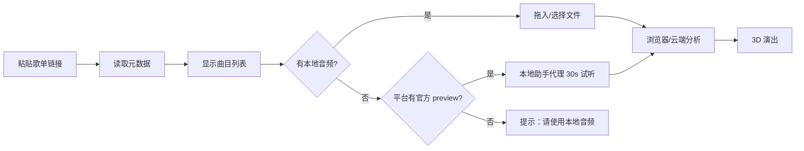

# 歌单导入与合规说明

> 目标：让用户把**自己平台账号里的歌单**带进 EchoStage，同时不越过版权、账号与平台条款的边界。

---

## 1. 产品原则

1. **只读元数据**：歌单名、曲名、艺人、专辑、时长、封面。
2. **音频从合法来源来**：用户本地文件，或平台明确提供的试听片段。
3. **不抓取完整版权音频**，不破解加密，不绕过 VIP / DRM。
4. **不缓存、不分发**平台音频；代理只做一次性转发。
5. **本地优先**：歌单助手只监听 `127.0.0.1`，音频分析默认在浏览器内完成。

---

## 2. 平台矩阵

| 平台 | 接入方式 | 元数据 | 音频 | 备注 |
|---|---|---|---|---|
| 网易云音乐 | 非官方 Web API | ✅ 实测 200 首 | ❌ | 接口可能变更；需遵守平台条款 |
| QQ 音乐 | 非官方 Web API | ✅ 实测 30 首 | ❌ | 同上 |
| Spotify | 官方 Web API（Client Credentials） | ✅ | 仅 `preview_url` | 官方接口稳定；preview 常为空 |
| Apple Music | MusicKit（需开发者 Token / 用户授权） | 可做 | 受 DRM 保护 | 未在原型中接入 |
| YouTube Music | 无官方公开 API | 不建议 | ❌ | 不接入 |
| 本地文件 | File System / File API | ✅ | ✅ | 用户自己的音频 |

> 表中“实测”指 2026-10 在本机通过 `pipeline/server.py` 读取公开歌单的结果；平台可能随时调整。

---

## 3. 网易云：接口与边界

### 3.1 读取歌单

```http
GET https://music.163.com/api/v6/playlist/detail?id={playlistId}&n=1000&s=0
Referer: https://music.163.com/
User-Agent: Mozilla/5.0 ...
Cookie: NMTID=...            # 可选；某些歌单/地区需要登录
```

返回：

- `playlist.name`、`playlist.coverImgUrl`
- `playlist.tracks[]`：`name`、`ar[].name`、`al.name`、`al.picUrl`、`dt`

只映射这些字段，不请求 `song/url` 等音频地址。

### 3.2 为什么不做音频

- 网易云音频受账号权益、地区、版权方限制；匿名接口通常返回 `url: null` 或 `code: -110`。
- 逆向 `song/url`、解密 `eapi`、抓取 CDN 完整音频，属于绕过平台技术措施，风险高。
- 产品选择：**元数据 + 用户本地音频 / 平台官方试听**。

### 3.3 登录态

- 可选环境变量 `NETEASE_COOKIE`，仅用于读取用户有权查看的歌单元数据。
- 不记录、不上传 Cookie；本地助手日志不打印 Cookie。
- 用户退出登录 / Cookie 过期后，回退到匿名可读歌单。

---

## 4. QQ 音乐

```http
GET https://c.y.qq.com/qzone/fcg-bin/fcg_ucc_getcdinfo_byids_cp.fcg
    ?type=1&json=1&utf8=1&disstid={id}&format=json&platform=yqq.json
Referer: https://y.qq.com/
```

映射：

- `cdlist[0].dissname` → 歌单名
- `songlist[].songname` / `singer[].name` / `albumname` / `interval`
- `albummid` → 封面 `https://y.gtimg.cn/music/photo_new/T002R300x300M000{albummid}.jpg`

同样只取元数据，不请求播放地址。

---

## 5. Spotify（官方）

1. 在 Spotify Developer Dashboard 创建 App。
2. 设置环境变量：

```bash
SPOTIFY_CLIENT_ID=...
SPOTIFY_CLIENT_SECRET=...
```

3. 使用 Client Credentials 获取 token，读取：

```http
GET https://api.spotify.com/v1/playlists/{id}
GET https://api.spotify.com/v1/playlists/{id}/tracks?limit=100
```

4. `track.preview_url` 是平台明确提供的 30 秒试听；可能为 `null`。
5. 若为空，UI 显示「需本地音频」，不尝试其他来源。

> Spotify 的 `preview_url` 近年大量下线；不要把“可试听”当作产品承诺。

---

## 6. 本地助手的安全设计

`pipeline/server.py`：

- 默认绑定 `127.0.0.1:8787`，不暴露公网。
- CORS 允许本地页面访问；无鉴权，但只监听本机。
- `/api/audio` 代理白名单：
  - `*.music.126.net`
  - `*.qqmusic.qq.com`
  - `*.scdn.co` / `*.spotifycdn.com`
- 仅允许 `http(s)`，限制 20MB，拒绝 `text/html` / `application/json`（防止把网页当音频）。
- 不写磁盘、不缓存；`Cache-Control: no-store`。
- 不做任意 URL 代理，降低 SSRF 风险。

生产化建议：

- 加一次性 token / Origin 校验；
- 限流；
- 把平台请求放到服务端，而不是用户浏览器直连；
- 记录“平台 + 接口 + 状态码”，不记录音频内容。

---

## 7. 推荐的上传路径



---

## 8. 法律与条款（非法律意见）

- 网易云 / QQ 的非官方接口可能违反平台《用户协议》或《API 使用条款》；仅建议**个人、非商业、低频**使用。
- 商业产品应优先申请官方开放平台权限，或与版权方 / 平台合作。
- 不要抓取、存储、转码、分发完整歌曲；不要绕过付费、地区限制或 DRM。
- 用户上传的音频应确保其拥有版权或授权；产品应提供侵权投诉/删除机制。
- 封面图、艺人名等元数据的使用也可能涉及版权/商标；公开产品需评估。
- 本文不构成法律意见，上线前请咨询专业律师。

---

## 9. 如何新增平台

实现 `pipeline/providers/base.py` 的 `PlaylistProvider`：

```python
class MyProvider(PlaylistProvider):
    name = "myplatform"
    label = "My Platform"
    patterns = (r"myplatform\.com",)

    def fetch(self, url: str) -> Playlist:
        ...
        return Playlist(title=..., platform=self.name, tracks=[Track(...)])
```

然后在 `pipeline/providers/__init__.py` 注册。

要求：

- 只返回元数据；
- 失败时抛出 `ProviderError`，带可读原因；
- 不实现任何解密/绕过逻辑；
- 为平台请求设置超时与合理 UA；
- 遵守平台 robots / 条款。
